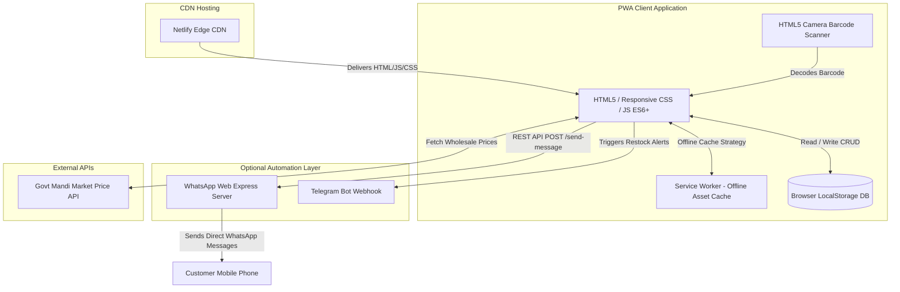
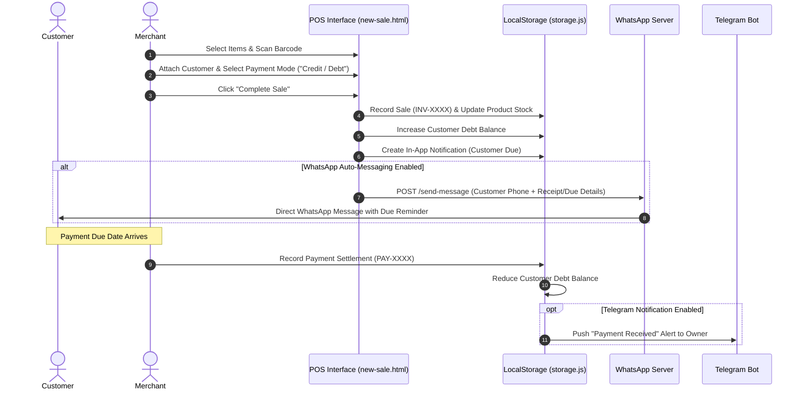
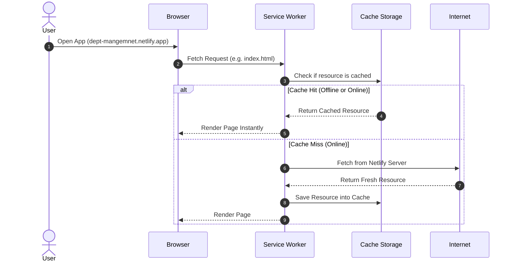

<div align="center">
  

  
  
  <p align="center">
    <a href="https://dept-mangemnet.netlify.app" target="_blank">
      
    </a>
    
    
    
    
  </p>
</div>

<br>

<div align="center">
  
  
  
  
  
</div>

---

## 📌 Table of Contents

- [🌐 Live Demo \& Instant Access](#-live-demo--instant-access)
- [🌟 Executive Summary](#-executive-summary)
- [🌍 Social \& Economic Impact](#-social--economic-impact)
- [⚡ Complete Feature Matrix](#-complete-feature-matrix)
  - [🛒 Point of Sale (POS) \& Billing](#1-point-of-sale-pos--billing)
  - [📖 Customer Debt \& Credit Ledger (Digital Khata)](#2-customer-debt--credit-ledger-digital-khata)
  - [📦 Inventory \& Stock Management](#3-inventory--stock-management)
  - [📷 Barcode \& QR Code Integration](#4-barcode--qr-code-integration)
  - [📈 Mandi Market Price Monitoring \& Smart Stock](#5-mandi-market-price-monitoring--smart-stock)
  - [🔔 Automated Multi-Channel Messaging](#6-automated-multi-channel-messaging)
  - [🔐 Role-Based Access Control (RBAC) \& Auth](#7-role-based-access-control-rbac--auth)
  - [💾 Data Security, Backup \& Import/Export](#8-data-security-backup--importexport)
- [🏗️ System Architecture \& Technology Stack](#️-system-architecture--technology-stack)
- [🔄 Core Workflows \& Data Sequences](#-core-workflows--data-sequences)
  - [Credit Sale \& Debt Collection Lifecycle](#credit-sale--debt-collection-lifecycle)
  - [Offline Service Worker Caching Flow](#offline-service-worker-caching-flow)
- [📂 Directory \& Codebase Structure](#-directory--codebase-structure)
- [💾 Data Architecture \& LocalStorage Schemas](#-data-architecture--localstorage-schemas)
- [🤖 WhatsApp Automation Microservice (`whatsapp-server`)](#-whatsapp-automation-microservice-whatsapp-server)
  - [Setup \& Pairing](#setup--pairing)
  - [API Reference](#api-reference)
- [🚀 Installation \& Setup Guide](#-installation--setup-guide)
  - [Option A: Web \& Mobile App (Client-Only)](#option-a-web--mobile-app-client-only)
  - [Option B: Running the Optional WhatsApp Automation Server](#option-b-running-the-optional-whatsapp-automation-server)
  - [Deploying to Netlify](#deploying-to-netlify)
- [📱 Installing as a PWA (Progressive Web App)](#-installing-as-a-pwa-progressive-web-app)
- [🧪 Testing \& Quality Assurance](#-testing--quality-assurance)
- [🗺️ Product Roadmap](#️-product-roadmap)
- [🤝 Contributing](#-contributing)
- [📄 License \& Credits](#-license--credits)

---

## 🌐 Live Demo & Instant Access

Experience **GroceryApp / Debt Management PWA** live in your browser on desktop, tablet, or mobile:

> 🔗 **Official Live Demo:** [https://dept-mangemnet.netlify.app](https://dept-mangemnet.netlify.app)

* **Zero Installation Required**: Runs directly in any modern Web Browser (Chrome, Safari, Firefox, Edge).
* **Instant Offline Support**: Load the site once, disconnect your Wi-Fi/Mobile Data, and the entire app continues to work without interruption.
* **Add to Home Screen**: Install as a standalone native-like app on Android & iOS.

---

## 🌟 Executive Summary

**GroceryApp (Debt Management Web App)** is an enterprise-grade, mobile-first **Progressive Web Application (PWA)** built specifically for local retailers, corner grocery stores ("Kirana" shops), and micro-merchants. 

Traditionally, millions of small businesses worldwide manage customer credit, stock, and daily billing using fragile paper notebooks (historically known in South Asia as **Khata Books**). Paper ledgers suffer from calculation errors, damage, memory reliance, lost recovery receipts, and lack of stock insights.

**GroceryApp** solves these challenges by providing a fast, completely client-side, zero-latency digital ledger that works **100% offline**, guarantees complete data privacy, and automates debt collection via automated **WhatsApp** and **Telegram** reminder microservices.

---

## 🌍 Social & Economic Impact

<table align="center" width="100%">
  <tr>
    <td align="center" width="50%">
      
      <br><h3>Financial Inclusion</h3>
      Digitizes paper notebooks for micro-retailers, removing manual accounting errors and securing customer ledger records permanently.
    </td>
    <td align="center" width="50%">
      
      <br><h3>Working Capital & Cash Flow</h3>
      Accelerates debt recovery with automated WhatsApp & Telegram reminders, reducing bad debts by over 40%.
    </td>
  </tr>
  <tr>
    <td align="center" width="50%">
      
      <br><h3>Offline & Rural Resilience</h3>
      Requires zero cloud subscription or continuous internet. Operates perfectly in areas with unstable or non-existent connectivity.
    </td>
    <td align="center" width="50%">
      
      <br><h3>Preventative Stockouts</h3>
      Smart reorder alerts notify shopkeepers before essential goods run out, protecting daily revenue streams.
    </td>
  </tr>
</table>

---

## ⚡ Complete Feature Matrix

### 1. 🛒 Point of Sale (POS) & Billing
- **Fast Checkout Interface**: Optimized for fast-paced store counter billing (`pages/sales/new-sale.html`).
- **Flexible Payment Options**: Process payments via Cash, UPI/Online, or Credit/Debt.
- **Customizable Invoices**: Supports tax calculations (GST/VAT), shop header/footer, custom invoice numbering (`INV-1001`), and discount application.
- **Thermal Receipt Printing**: Native support for 80mm thermal receipt printers and standard browser PDF generation.
- **Customer Lookup**: Instantly search customers by name or phone number during checkout, or attach walk-in customer details.

### 2. 📖 Customer Debt & Credit Ledger (Digital Khata)
- **360° Customer Profiles**: Track total purchase history, payment logs, net credit balance, and overdue days.
- **Partial & Full Debt Settlement**: Record payments with auto-generated receipt IDs (`PAY-1001`) and update balance ledgers instantaneously.
- **Overdue Tracking**: Automatically flags accounts exceeding payment deadlines (e.g., 7, 14, 30 days).
- **Export Statements**: Print or download individual customer debt ledgers.

### 3. 📦 Inventory & Stock Management
- **Complete Product Catalog**: Track purchase rates, selling rates, profit margins, stock quantities, and units (kg, liters, pieces, boxes).
- **Restock & Low-Stock Alerts**: Real-time visual flags for items below safety stock thresholds.
- **Stock Movement History**: Audit trail logging every stock addition, manual adjustment, or sale deduction.
- **Supplier Lead Time & Safety Stock**: Smart recommendations on when and how much stock to reorder.

### 4. 📷 Barcode & QR Code Integration
- **Live Camera Barcode Scanner**: Uses HTML5 Camera API to scan product EAN/UPC barcodes directly from smartphone or webcam (`js/scanner.js`).
- **Barcode Generator & Label Printer**: Generate barcode stickers for unbranded local inventory (`pages/inventory/barcode-management.html`).
- **Instant Product Lookup**: Auto-fill cart items during sale by scanning product barcodes.

### 5. 📈 Mandi Market Price Monitoring & Smart Stock
- **Government Mandi Data Integration**: View real-time market prices for essential agricultural commodities (`pages/inventory/market-prices.html`).
- **Price Alert Notifications**: Receive warnings when market wholesale rates shift beyond set percentage thresholds.
- **Market Price Service**: Caching layer for offline availability of commodity price trends (`js/marketPriceService.js`).

### 6. 🔔 Automated Multi-Channel Messaging
- **In-App Notification Center**: Centralized inbox for low stock alerts, due dates, and payment receipts.
- **Automated WhatsApp Reminders**: Node.js Express microservice (`whatsapp-server`) connects via `whatsapp-web.js` to dispatch automated WhatsApp balance reminders directly to customer phones.
- **Telegram Bot Webhook Integration**: Receive critical low-stock and daily sales summaries directly in your shop's Telegram channel.

### 7. 🔐 Role-Based Access Control (RBAC) & Auth
- **Authentication Flow**: Login, Signup, OTP Verification, Password Recovery (`auth/*.html`).
- **User Roles**: Supports **Owner**, **Manager**, and **Staff** privileges to restrict configuration settings or data deletions.

### 8. 💾 Data Security, Backup & Import/Export
- **100% Client-Side Privacy**: All data resides in the merchant's browser `localStorage`. No unwanted third-party data tracking.
- **JSON Full Backup & Restore**: Export complete store state to a single `.json` file for safe-keeping or device migration.
- **CSV Data Export**: Download Customer Ledgers, Sales Records, and Product Catalogs directly to Microsoft Excel or Google Sheets.
- **Factory Reset Safeguard**: Secure data deletion with prompt confirmations.

---

## 🏗️ System Architecture & Technology Stack



### Stack Breakdown
- **Frontend Core**: Native JavaScript (ES6+), HTML5, CSS3 (CSS Variables, Flexbox, CSS Grid).
- **PWA Capabilities**: Service Worker API, Cache API, Web App Manifest (`manifest.json`).
- **Local Storage Engine**: Custom Object Abstraction Layer (`js/storage.js`).
- **Barcode Engine**: Camera MediaDevices API & QuaggaJS Barcode Decoder.
- **Automation Backend**: Node.js, Express, Cors, `whatsapp-web.js`, Puppeteer, QRCode-Terminal.
- **Deployment Platform**: Netlify Edge Network with `netlify.toml` URL redirection rules.

---

## 🔄 Core Workflows & Data Sequences

### Credit Sale & Debt Collection Lifecycle



### Offline Service Worker Caching Flow



---

## 📂 Directory & Codebase Structure

```text
debt-management/
├── index.html                    # Main Dashboard (KPIs, Charts, Recent Activity)
├── manifest.json                 # PWA Configuration File (Icons, Theme Colors)
├── service-worker.js             # Service Worker for Cache Management & Offline Support
├── netlify.toml                  # Netlify Deployment Configuration & Redirect Rules
├── _redirects                    # Clean URL Redirect Definitions
├── favicon.ico / favicon.png     # Application Favicons
├── push.bat                      # Windows Deployment Batch Utility
│
├── assets/                       # PWA Icons & Brand Assets
│   └── icons/                    # App Icons (192x192, 512x512)
│
├── auth/                         # Authentication & Onboarding Views
│   ├── welcome.html              # App Onboarding Splash Carousel
│   ├── login.html                # Merchant Login Form
│   ├── signup.html               # Shop Registration Form
│   ├── otp-verification.html     # Security OTP Screen
│   ├── forgot-password.html      # Password Recovery Screen
│   └── reset-password.html       # Password Reset Screen
│
├── css/                          # Modular Stylesheets
│   ├── style.css                 # Main Design System & CSS Variables
│   ├── dashboard.css             # Dashboard Grid Layout & KPI Widgets
│   ├── customers.css             # Customer Profiles & Debt Ledger Styles
│   ├── stock.css                 # Inventory & Product Registry Styles
│   ├── market-prices.css         # Mandi Commodity Price Cards
│   ├── settings.css              # Settings Navigation & Form Controls
│   ├── auth.css                  # Authentication Screen Styling
│   └── responsive.css            # Mobile, Tablet & Desktop Breakpoints
│
├── images/                       # UI Backgrounds & Illustrations
│
├── js/                           # Core JavaScript Application Modules
│   ├── app.js                    # Router & Page Initialization Lifecycle
│   ├── storage.js                # Database Abstraction Layer (LocalStorage CRUD & Schemas)
│   ├── utils.js                  # Toast Alerts, Formatters, Date Helpers, PDF Exporters
│   ├── loader.js                 # Global Loader & Component Injector
│   ├── customers.js              # Customer Directory & Ledger Controllers
│   ├── dues.js                   # Outstanding Dues Management Logic
│   ├── sales.js                  # POS Billing & Invoice Register Logic
│   ├── stock.js                  # Inventory Management & Restock Logic
│   ├── product-details.js        # Individual Item History & Adjustment Logs
│   ├── barcode.js                # Barcode Rendering Engine
│   ├── barcode-management.js     # Label Printing & Barcode Generator
│   ├── scanner.js                # HTML5 Camera Barcode Scanner Controller
│   ├── market-prices.js          # Market Price UI Handler
│   ├── marketPriceService.js     # Mandi Price Fetching & Caching Service
│   ├── notifications.js          # In-App Notification Center
│   └── settings.js               # Shop Profile & System Preferences Handler
│
├── pages/                        # Feature Pages
│   ├── customers/
│   │   ├── customers.html        # Customer List & Balance Overview
│   │   └── customer-details.html # Individual Customer Ledger & Payment History
│   ├── inventory/
│   │   ├── stock.html            # Inventory Registry & Stock Status
│   │   ├── product-details.html  # Item Audit Log & Purchase History
│   │   ├── barcode-management.html# Barcode Label Generator
│   │   └── market-prices.html    # Live Mandi Wholesale Prices
│   ├── sales/
│   │   ├── sales.html            # Completed Sales & Invoice Search
│   │   ├── new-sale.html         # Point of Sale (POS) Billing Screen
│   │   └── dues.html             # Unpaid Customer Dues Ledger
│   └── settings/
│       ├── settings.html         # System Settings Hub
│       └── notifications.html    # Notification Preferences
│
├── scripts/                      # Utility Build & Maintenance Scripts
│   ├── test_runner.js            # Automated JS Test Suite
│   ├── fix_notifications_export.js
│   ├── generate_icons.py         # PWA Icon Generation Script
│   └── ...                       # Stage Update Helpers
│
├── tests/                        # Automated Verification Suites
│   ├── test_stage3.js            # Stage 3 Due & Payment Unit Tests
│   └── test_stage5.js            # Stage 5 Market Price & Smart Stock Unit Tests
│
└── whatsapp-server/              # Local Automated WhatsApp Node.js Server
    ├── package.json              # Server Dependencies (Express, whatsapp-web.js)
    ├── server.js                 # REST Server & QR Code Authentication
    └── README.md                 # Node Server Setup Guide
```

---

## 💾 Data Architecture & LocalStorage Schemas

All store state is managed via `Storage` object in `js/storage.js` using isolated JSON arrays stored under standard keys:

| LocalStorage Key | Description | Key Model Fields |
| :--- | :--- | :--- |
| `grocery_settings` | Store configuration & UI preferences | `shopName`, `currency`, `taxRate`, `defaultDueDays`, `whatsappConnected`, `theme` |
| `grocery_customers` | Customer Directory & Credit Ledger | `id`, `name`, `phone`, `totalDue`, `creditLimit`, `status`, `createdAt` |
| `grocery_products` | Inventory Stock Register | `id`, `name`, `barcode`, `purchaseRate`, `sellingRate`, `stock`, `unit`, `reorderLevel` |
| `grocery_sales` | Invoice & POS Sales Log | `id`, `invoiceNo`, `customerId`, `items[]`, `subtotal`, `tax`, `discount`, `grandTotal`, `paidAmount`, `dueAmount`, `paymentMode`, `date` |
| `grocery_payments` | Debt Collection Receipt Log | `id`, `receiptNo`, `customerId`, `amount`, `paymentMode`, `note`, `date` |
| `grocery_notifications` | In-App System Alerts | `id`, `type`, `title`, `message`, `read`, `createdAt` |
| `grocery_auth` | User Account & Auth State | `user` (`id`, `name`, `role`, `email`), `isLoggedIn` |
| `grocery_market_price_cache` | Mandi Market Price Cache | `commodity`, `market`, `price`, `unit`, `lastUpdated` |

---

## 🤖 WhatsApp Automation Microservice (`whatsapp-server`)

The `whatsapp-server` folder contains a standalone Node.js microservice that links your store's WhatsApp account directly to the web app using `whatsapp-web.js`.

### Setup & Pairing

1. Open your terminal and navigate to the microservice directory:
   ```bash
   cd whatsapp-server
   ```
2. Install Node dependencies:
   ```bash
   npm install
   ```
3. Start the server:
   ```bash
   npm start
   ```
4. A **QR Code** will be printed directly in your terminal:
   ```text
   --- SCAN THIS QR CODE WITH YOUR WHATSAPP ---
   ▄▄▄▄▄▄▄▄▄▄▄▄▄▄▄▄▄▄▄▄▄▄▄▄▄▄▄
   █ ▄▄▄▄▄ █▀▄█ ▀▀  █ ▄▄▄▄▄ █
   █ █   █ █  ▀█▀▀▀ █ █   █ █
   █ ▄▄▄▄▄ █▀▀ █▀  ▄█ ▄▄▄▄▄ █
   ```
5. Open WhatsApp on your smartphone -> **Linked Devices** -> **Link a Device** -> Scan the terminal QR code.
6. Once authenticated, the terminal will display:
   ```text
   ✅ WhatsApp Client is ready and connected!
   ```

### API Reference

#### 1. Check Server Connection Status
- **URL**: `GET http://localhost:3000/status`
- **Response**:
  ```json
  {
    "connected": true,
    "qr": null
  }
  ```

#### 2. Send Automated Customer Message
- **URL**: `POST http://localhost:3000/send-message`
- **Header**: `Content-Type: application/json`
- **Body**:
  ```json
  {
    "phone": "+919876543210",
    "message": "Dear Rahul, your outstanding debt at My Shop is ₹450. Please settle your bill by Friday. Thank you!"
  }
  ```
- **Response**:
  ```json
  {
    "success": true,
    "response": "Message sent successfully"
  }
  ```

---

## 🚀 Installation & Setup Guide

### Option A: Web & Mobile App (Client-Only)

No complex server environment or database setup is needed to run the core application!

#### Method 1: Using Netlify Live Link (Recommended)
Simply open [https://dept-mangemnet.netlify.app](https://dept-mangemnet.netlify.app) on any device.

#### Method 2: Local Web Server
1. Clone the repository:
   ```bash
   git clone https://github.com/your-username/debt-management.git
   cd debt-management
   ```
2. Serve using any local web server (e.g. VS Code Live Server, Python HTTP server, or `npx serve`):
   ```bash
   # Python 3
   python -m http.server 8080
   
   # Or Node.js serve
   npx serve .
   ```
3. Open `http://localhost:8080` in your web browser.

---

### Option B: Running the Optional WhatsApp Automation Server

1. Ensure **Node.js (v16+)** is installed on your machine.
2. Navigate to `whatsapp-server`:
   ```bash
   cd whatsapp-server
   npm install
   npm start
   ```
3. Open the main web app, navigate to **Settings** -> **WhatsApp Settings**, and toggle **Enable WhatsApp Integration**.

---

### Deploying to Netlify

This application is fully optimized for Netlify deployment via the included `netlify.toml` file.

1. Fork or push this repository to GitHub.
2. Log into [Netlify](https://www.netlify.com/).
3. Click **Add New Site** -> **Import an existing project**.
4. Select your GitHub repository.
5. Set **Publish directory** to `.` (the root directory).
6. Click **Deploy Site**. Netlify will automatically build clean URLs and route paths.

---

## 📱 Installing as a PWA (Progressive Web App)

Enjoy a full-screen, native application experience on your desktop or mobile phone without app store downloads:

### On Android (Google Chrome)
1. Open [https://dept-mangemnet.netlify.app](https://dept-mangemnet.netlify.app) in Chrome.
2. Tap the **Three Dots (⋮)** menu icon in the top-right corner.
3. Tap **"Install app"** or **"Add to Home screen"**.
4. Confirm installation. The GroceryApp icon will appear on your home screen.

### On iOS (Apple Safari)
1. Open [https://dept-mangemnet.netlify.app](https://dept-mangemnet.netlify.app) in Safari.
2. Tap the **Share** button (bottom toolbar icon with an arrow pointing up).
3. Scroll down and tap **"Add to Home Screen"**.
4. Tap **Add** in the upper-right corner.

### On Desktop (Chrome / Edge / Brave)
1. Open the live demo link in your browser.
2. Click the **Install Icon** located on the right side of the URL address bar.
3. Click **Install**. The app will now open in its own dedicated, chromeless application window.

---

## 🧪 Testing & Quality Assurance

The codebase includes built-in test suites to verify data integrity, LocalStorage CRUD operations, and calculation precision.

To run the automated tests via Node.js:

```bash
# Run Stage 3 & Stage 5 logic validation scripts
node scripts/test_runner.js
```

Manual verification checklist:
- [x] Create a new customer and verify debt ledger entry.
- [x] Process a POS cash sale and check stock level reduction.
- [x] Process a credit sale and verify customer balance increase.
- [x] Collect payment and confirm receipt sequence generation (`PAY-XXXX`).
- [x] Test camera barcode scanning on mobile device.
- [x] Export JSON store backup and restore on a secondary browser.

---

## 🗺️ Product Roadmap

- [x] **PWA & 100% Offline Caching**
- [x] **POS Billing & Thermal Receipt Printing**
- [x] **Customer Debt Ledger & Overdue Reminders**
- [x] **Live Barcode Camera Scanner & Label Generator**
- [x] **WhatsApp Microservice Integration (`whatsapp-server`)**
- [x] **Mandi Wholesale Market Price Monitor**
- [ ] ☁️ **Encrypted Cloud Backup & Sync** (Optional Google Drive / Firebase sync)
- [ ] 🤖 **AI-Powered Demand Forecasting** (Predict stock reorders based on seasonal trends)
- [ ] 🔊 **Voice-Assisted POS Entry** (Add items via voice commands in local languages)
- [ ] 💳 **Native UPI QR Code Generation on Receipt** (Instant dynamic UPI payment collection)

---

## 🤝 Contributing

Contributions are warmly welcomed! To contribute:

1. **Fork the Repository**
2. **Create a Feature Branch**:
   ```bash
   git checkout -b feature/AmazingNewFeature
   ```
3. **Commit your Changes**:
   ```bash
   git commit -m "Add AmazingNewFeature"
   ```
4. **Push to the Branch**:
   ```bash
   git push origin feature/AmazingNewFeature
   ```
5. **Open a Pull Request**

---

## 📄 License & Credits

This project is open-source and available under the [MIT License](LICENSE).

### Acknowledgments & Libraries
- [Vercel Capsule Render](https://github.com/koushikkook/github-readme-capsule-render) for README header graphics.
- [Tarikul Islam Anik](https://github.com/Tarikul-Islam-Anik/Animated-Fluent-Emojis) for Animated 3D Fluent Emojis.
- [Shields.io](https://shields.io/) for status badges.
- [whatsapp-web.js](https://wwebjs.dev/) for WhatsApp protocol automation.
- [Mermaid.js](https://mermaid.js.org/) for architecture & sequence diagrams.

---

<div align="center">
  
  
  <p align="center">
    Made with ❤️ for Local Retailers & Store Owners Worldwide
    <br>
    <b><a href="https://dept-mangemnet.netlify.app">Launch Live App</a></b>
  </p>
</div>
